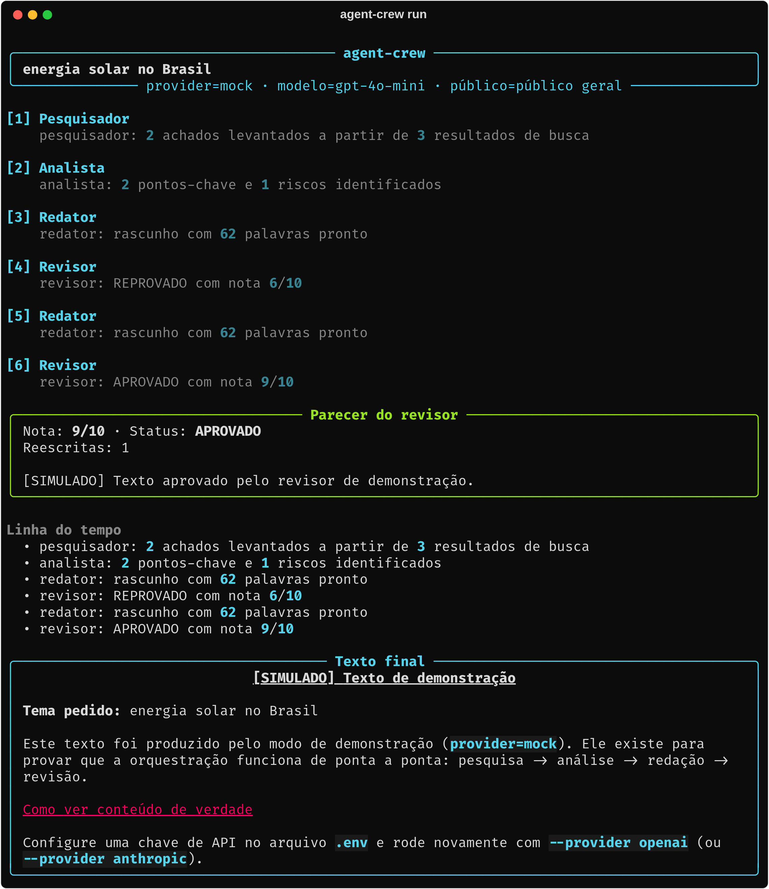
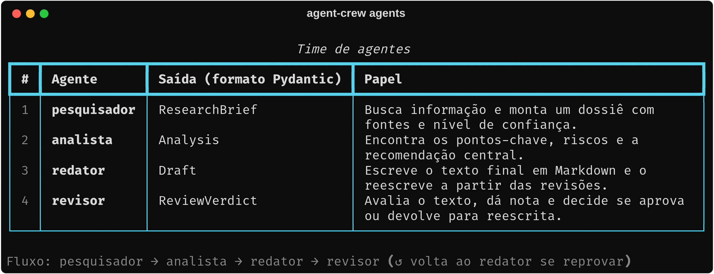

<div align="center">

# agent-crew

**Um time de agentes de IA que pesquisa, analisa, escreve e revisa — sozinho.**

Quatro agentes especializados transformam uma pergunta em um texto revisado,
com um ciclo de qualidade que devolve o rascunho para reescrita quando a nota
é baixa. Roda **offline e sem chave de API** — clone e execute em segundos.

[](https://github.com/GuiNascimento77/agent-crew/actions/workflows/ci.yml)


`LangGraph` · `Pydantic AI` · `FastAPI` · `Typer` · `Rich`

</div>

<p align="center">
  
</p>

> Na imagem: o revisor **reprovou** o primeiro texto (nota 6/10), o fluxo
> voltou ao redator e a segunda versão foi **aprovada** (9/10). Esse ciclo é o
> coração do projeto.

---

## O problema que ele resolve

A maioria dos exemplos de "agentes de IA" é um prompt gigante que pede tudo de
uma vez — difícil de testar, difícil de melhorar, impossível de depurar.
Aqui o trabalho é dividido em **papéis pequenos**, cada um com uma entrada, uma
saída tipada e uma responsabilidade clara.

<p align="center">
  
</p>

## Como funciona

```
   ┌──────────────┐   ┌───────────┐   ┌──────────┐   ┌───────────┐
   │ PESQUISADOR  │──▶│ ANALISTA  │──▶│ REDATOR  │──▶│ REVISOR   │
   └──────────────┘   └───────────┘   └──────────┘   └─────┬─────┘
                                            ▲              │
                                            └── reprovado ─┘
                                                aprovado ──▶ fim
```

O fluxo é um **grafo de estados** do LangGraph (`src/agent_crew/graph.py`).
A única decisão do sistema cabe em 8 linhas:

| Situação do revisor | O que acontece |
|---|---|
| Texto aprovado | O fluxo termina |
| Reprovado, ainda há tentativas | Volta para o redator reescrever |
| Reprovado, limite atingido | Termina mesmo assim, com o parecer anexado |

A terceira linha é a **trava contra loop infinito**, um dos erros mais comuns
em sistemas com agentes — e tem teste dedicado.

## Rode agora (sem chave de API)

```bash
git clone https://github.com/GuiNascimento77/agent-crew.git
cd agent-crew

python3 -m venv .venv && source .venv/bin/activate   # Windows: .venv\Scripts\activate
pip install -e ".[dev]"

agent-crew run "energia solar no Brasil"
```

Por padrão usa o provedor `mock`: um modelo de demonstração determinístico,
**claramente marcado como simulado**. Ele prova que a orquestração funciona;
para texto de verdade, veja [usando um LLM real](docs/guia-de-uso.md#usando-um-llm-de-verdade)
(OpenAI ou Anthropic, com uma linha no `.env`).

### Ou suba a API

```bash
agent-crew serve        # abra http://127.0.0.1:8000/docs
```

```bash
curl -X POST http://127.0.0.1:8000/crew/run \
  -H 'Content-Type: application/json' \
  -d '{"question": "O que é o protocolo MCP?", "max_revisions": 1}'
```

| Rota | Para que serve |
|---|---|
| `POST /crew/run` | Roda o time e devolve o pacote completo (dossiê, análise, texto, parecer) |
| `POST /crew/stream` | Mesmo fluxo, com o progresso ao vivo via SSE |
| `GET /agents` · `/providers` · `/health` | Inspeção e saúde do serviço |

## Decisões de projeto

- **Saída estruturada, não texto solto.** Cada agente devolve um modelo Pydantic
  (`ResearchBrief`, `Analysis`, `Draft`, `ReviewVerdict`). O Pydantic AI obriga
  o LLM a responder nesse formato e repete a chamada se vier errado.
- **Camada de LLM isolada** (`llm.py`). O resto do código não sabe qual modelo
  está atrás — trocar de provedor é uma linha no `.env`, e testar é de graça.
- **Fachada única** (`crew.py`). CLI e API só chamam `run_crew()` e
  `stream_crew()`; o grafo pode mudar sem que eles percebam.
- **Testável sem IA.** Com o `MockLLM`, os 30 testes rodam offline, em menos de
  1 segundo, sem resultado "piscando" — o CI no GitHub roda os mesmos.

Detalhes em [`docs/arquitetura.md`](docs/arquitetura.md).

## O que aprendi construindo

- **Orquestração com grafos:** estado compartilhado, nós, arestas condicionais
  e *reducers* (`operator.add`) para acumular a linha do tempo em vez de
  sobrescrevê-la.
- **Saída estruturada com LLMs:** contratos Pydantic entre agentes em vez de
  parsear texto livre.
- **Inversão de dependência na prática:** um dublê de LLM que torna sistemas
  com IA testáveis de verdade.
- **Falhas de sistemas com agentes:** loops sem fim, estado que cresce e erros
  de configuração que viram mensagens claras (HTTP 400 e não um *traceback*).
- **Engenharia em volta do modelo:** CLI com Typer/Rich, API com FastAPI
  (incluindo streaming SSE), CI com GitHub Actions, lint e formatação com Ruff.

## Estrutura

```
src/agent_crew/
├── agents/        # os 4 agentes (pesquisador, analista, redator, revisor)
├── tools/         # busca na web (mock + Tavily)
├── graph.py       # o grafo e a decisão do revisor
├── crew.py        # fachada: run_crew() / stream_crew()
├── llm.py         # Pydantic AI (real) + MockLLM (dublê de testes)
├── schemas.py     # contratos de dados de cada agente
├── cli.py · api.py
tests/             # 30 testes, 100% offline
examples/          # 6 scripts curtos para entender cada peça
docs/              # guia de uso, arquitetura, tour do código, exercícios
```

## Próximos passos

- [ ] Observabilidade (Langfuse/LangSmith): custo e latência por chamada
- [ ] Avaliação automática (evals) para medir a qualidade a cada mudança
- [ ] Aprovação humana antes da redação (`interrupt` + checkpointer)
- [ ] Pesquisadores em paralelo sobre ângulos diferentes do tema
- [ ] `Dockerfile` para subir a API em qualquer lugar

## Documentação

| | |
|---|---|
| [`docs/guia-de-uso.md`](docs/guia-de-uso.md) | Guia completo: LLM real, busca real, API, todos os comandos do CLI |
| [`docs/tour-do-codigo.md`](docs/tour-do-codigo.md) | Em que ordem ler cada arquivo e o que observar |
| [`docs/exercicios.md`](docs/exercicios.md) | 10 exercícios práticos, do simples ao desafio aberto |
| [`docs/arquitetura.md`](docs/arquitetura.md) · [`docs/como-funciona.md`](docs/como-funciona.md) | Decisões técnicas e o passo a passo do fluxo |
| [`CONTRIBUTING.md`](CONTRIBUTING.md) | Como contribuir, rodar e testar |

## Licença

MIT — veja [LICENSE](LICENSE).
