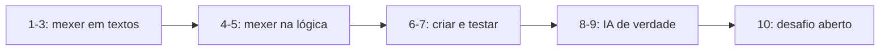

# Exercícios práticos

Do mais fácil ao mais difícil. Cada um diz **o que fazer**, **onde mexer** e
**como saber que funcionou**.

Regra de ouro: faça **um de cada vez**, rodando o projeto entre cada um.
Mexer em cinco coisas juntas e depois testar é a forma mais rápida de se
perder.

---

## Como saber que deu certo

Para quase todos os exercícios, os comandos de verificação são os mesmos:

```bash
# 1. O time roda e termina?
agent-crew run "seu tema aqui"

# 2. Os testes continuam passando?
pytest -q

# 3. O estilo do código está ok?
ruff check src tests
```

Se os três passam, você não quebrou nada. Se um falhar, **leia o erro** — ele
costuma dizer exatamente a linha e o motivo.

---

## Nível 1 — Aquecimento (5 a 10 min cada)

### Exercício 1 — Mudar o comportamento do revisor

**Objetivo:** entender que o comportamento de um agente mora nas instruções.

**Onde:** `src/agent_crew/agents/reviewer.py`, na propriedade `instructions`.

**O que fazer:** torne o revisor mais exigente. Troque a linha:

```python
"- `approved` = True somente se a nota for 8 ou mais E não houver "
"problema de fidelidade.\n"
```

por `9 ou mais`.

**Verifique:**

```bash
agent-crew run "qualquer tema" -r 3
```

**O que você deve ver:** o revisor reprovando mais vezes antes de aprovar —
e, se o limite for baixo, o fluxo terminando sem aprovação.

**Entenda:** você mudou **uma palavra** e o sistema inteiro mudou de
comportamento. Isso é o poder (e o perigo) de mexer em prompts.

---

### Exercício 2 — Mudar o idioma do time

**Objetivo:** entender a configuração e como ela chega até o agente.

**Onde:** arquivo `.env` (crie com `cp .env.example .env`).

**O que fazer:**

```ini
AGENT_CREW_LANGUAGE=English
```

**Verifique:** `python examples/03_ver_os_prompts.py` e olhe o system prompt
no final — *"Responda sempre em English."*

**Entenda:** os agentes escrevem apenas as instruções do **seu papel**. As
regras do time são adicionadas por `agents/base.py::system_prompt()`. Um
lugar só, todo o time obedece.

> Não esqueça de voltar para `pt-BR` depois.

---

### Exercício 3 — Ver a trava de segurança agindo

**Objetivo:** provar para si mesmo que o limite de revisões funciona.

**O que fazer:** rode com limites diferentes:

```bash
agent-crew run "qualquer tema" -r 0
agent-crew run "qualquer tema" -r 1
agent-crew run "qualquer tema" -r 3
```

**O que você deve ver:**

| `-r` | Passos executados | O que acontece |
|:---:|---|---|
| 0 | 4 | Reprova e entrega assim mesmo, com o parecer |
| 1 | 6 | Reprova → reescreve → aprova |
| 3 | até 10 | Pode reprovar mais vezes se o revisor for exigente |

**Entenda:** `-r 0` **não é um bug**. É o sistema entregando um texto
imperfeito com o parecer anexado, em vez de travar. Compare as linhas do
tempo das três execuções.

---

## Nível 2 — Mexendo na lógica (15 a 30 min cada)

### Exercício 4 — Adicionar um campo ao estado

**Objetivo:** entender como o estado circula entre os agentes.

**Onde:** `src/agent_crew/state.py` e `src/agent_crew/agents/researcher.py`.

**O que fazer:**

1. Em `state.py`, adicione uma chave:

```python
    # Quantos resultados a busca retornou (só para observabilidade)
    search_hits: int
```

2. Em `researcher.py`, faça o pesquisador preencher essa chave. Você já tem
   os resultados em `self._hits`:

```python
    def _apply(self, output: ResearchBrief, state: CrewState) -> dict[str, Any]:
        return {"brief": output, "search_hits": len(self._hits)}
```

**Verifique:**

```bash
python examples/02_ver_o_estado.py
```

A chave `search_hits` deve aparecer mudando no passo 1.

**Entenda:** você acabou de fazer um agente "publicar" um dado novo no estado
compartilhado, sem mexer em nenhum outro agente. É assim que um sistema
cresce sem virar um monstro.

---

### Exercício 5 — Quebrar o roteamento de propósito (e consertar)

**Objetivo:** entender o valor de ter testes.

**Onde:** `src/agent_crew/graph.py`, função `_route_after_review`.

**O que fazer:** comente a trava de segurança:

```python
    # if revisions >= max_revisions:
    #     return END
```

**Verifique:**

```bash
pytest -q
```

**O que você deve ver:** um teste falha, com a mensagem *"Sem esta trava, um
revisor exigente criaria um loop infinito"*.

Agora volte a linha e rode de novo: verde.

> ⚠️ **Não rode o CLI** com essa linha comentada e `provider=openai`. Sem a
> trava, o programa ficaria reescrevendo para sempre — e gastando de verdade.

**Entenda:** o teste falhou **antes** de você ter prejuízo. É exatamente por
isso que ele existe.

---

### Exercício 6 — Criar uma quinta persona: o "traductor"

**Objetivo:** praticar as três peças de um agente (contrato, agente, nó).

**O que fazer:** crie um agente que traduz o texto final para inglês, rodando
depois do revisor.

**1. O contrato** (`schemas.py`):

```python
class Translation(BaseModel):
    language: str = Field(description="Idioma de destino, ex.: 'en-US'")
    markdown: str = Field(description="O texto traduzido, em Markdown")
```

**2. O agente** (`agents/translator.py`) — use o `WriterAgent` como modelo:

```python
class TranslatorAgent(CrewAgent):
    name = "tradutor"
    description = "Traduz o texto final para outro idioma."
    output_type = Translation

    @property
    def instructions(self) -> str:
        return ("Você é um tradutor técnico. Traduza o texto para inglês "
                "preservando a formatação Markdown e o sentido exato. "
                "Não acrescente nem remova informação.")

    def build_prompt(self, state: CrewState) -> str:
        draft = state.get("draft")
        return f"Texto a traduzir:\n\n{draft.markdown if draft else '(vazio)'}"

    def _apply(self, output: Translation, state: CrewState) -> dict[str, Any]:
        return {"translation": output}
```

**3. Ligue tudo:**

- adicione `translation: Translation | None` em `state.py`
- adicione `TRANSLATOR = "tradutor"` em `graph.py`
- acrescente ao `AGENT_SEQUENCE` **depois** do revisor
- troque a aresta condicional: quando aprovado, vá para o tradutor em vez de
  `END`; do tradutor, vá para `END`

**Verifique:** `python examples/02_ver_o_estado.py` deve mostrar 7 passos.

**Entenda:** você acabou de mudar a **topologia** do sistema. Nenhum dos
quatro agentes originais precisou saber disso.

---

### Exercício 7 — Escrever um teste para um agente

**Objetivo:** perder o medo de escrever testes.

**Onde:** `tests/`, usando `tests/test_llm.py` como modelo.

**O que fazer:** escreva um teste que garanta que o analista devolve
pontos-chave:

```python
async def test_analista_produz_pontos_chave():
    from agent_crew.agents import AnalystAgent
    from agent_crew.agents.base import CrewContext
    from agent_crew.config import Settings
    from agent_crew.llm import MockLLM
    from agent_crew.schemas import ResearchBrief
    from agent_crew.tools.search import MockSearch

    settings = Settings(provider="mock", search_backend="mock")
    agente = AnalystAgent(CrewContext(settings=settings, llm=MockLLM(), search=MockSearch()))

    estado = {"question": "tema", "brief": ResearchBrief(question="tema", findings=[])}
    mudancas = await agente.act(estado)

    assert "analysis" in mudancas
    assert mudancas["analysis"].key_points
    assert "analista" in mudancas["timeline"][0]
```

**Verifique:** `pytest tests/test_agentes.py -v`

**Entenda:** as três `assert` são o "contrato" do analista, escrito de forma
executável. Agora, se você mexer nas instruções e ele parar de produzir
pontos-chave, o teste avisa.

---

## Nível 3 — Usando IA de verdade (30 min+)

### Exercício 8 — Rodar com um LLM real

**Objetivo:** ver o sistema gerando conteúdo de verdade.

**Onde:** arquivo `.env`.

**O que fazer:**

```ini
AGENT_CREW_PROVIDER=openai
AGENT_CREW_MODEL_NAME=gpt-4o-mini
OPENAI_API_KEY=sk-...
```

**Verifique:**

```bash
agent-crew providers      # confirme que a chave foi lida
agent-crew run "tema do seu interesse" -r 0    # -r 0 para gastar menos
```

**Compare:** pegue o mesmo tema rodando com `-p mock` e com `-p openai` e
compare as linhas do tempo. A diferença é o que o modelo acrescenta.

**Cuidados:**
- Comece com `-r 0`. Cada execução faz 4 a 6 chamadas ao modelo.
- `gpt-4o-mini` é o mais barato da OpenAI e suficiente para estudar.
- Se você tem [Ollama](https://ollama.com) instalado, dá para rodar local de
  graça: veja "Próximos passos" no README.

---

### Exercício 9 — Busca na web de verdade

**Objetivo:** ver a ferramenta (tool) trazendo dados reais.

**Onde:** `.env`.

**O que fazer:** crie uma conta gratuita na [Tavily](https://tavily.com),
pegue a chave e:

```ini
AGENT_CREW_SEARCH_BACKEND=tavily
TAVILY_API_KEY=tvly-...
```

**Verifique:**

```bash
agent-crew run "O que mudou no ecossistema de agentes de IA em 2026?" -r 0
```

Agora vá em `src/agent_crew/agents/researcher.py` e veja que **nada mudou**.
O agente continua chamando `self.context.search.search(...)`. Só a
implementação por trás da interface trocou.

**Entenda:** essa é a inversão de dependência pagando o investimento. Adicionar
um provedor novo custa ~20 linhas em `tools/search.py` e **zero** mudança nos
agentes.

---

## Nível 4 — Desafios abertos

### Exercício 10 — Escolha um dos desafios abaixo

**a) Fazer o pesquisador usar duas buscas em paralelo**

Ideia: gerar duas perguntas derivadas do tema e buscar as duas ao mesmo
tempo com `asyncio.gather`. Junte os resultados antes de sintetizar.

Pista: `asyncio.gather(busca1, busca2)` roda as duas simultaneamente.

---

**b) Adicionar custo por execução**

Ideia: a classe `LLMUsage` em `llm.py` já existe e não é usada. Registre os
tokens de entrada e saída de cada agente e exponha o total no `CrewResult`.

Pista: o Pydantic AI devolve `result.usage()` com os números.

---

**c) Um endpoint que roda só um agente**

Ideia: `POST /agents/{nome}/run` — roda um agente isolado sobre um estado
que você envia no corpo. Ótimo para depurar um agente específico sem rodar o
time inteiro.

Pista: `build_agents()` já devolve um dicionário por nome.

---

**d) Aprovação humana antes de escrever**

Ideia: pausar o grafo depois da análise e só continuar quando uma pessoa der
o "ok". O LangGraph tem `interrupt()` e `checkpointer` justamente para isso.

Pista: pesquise "human in the loop" na documentação do LangGraph.

---

## A ordem certa de aprender



Se você fez até o **7**, você já entende este projeto melhor do que a maioria
das pessoas que clona um repositório na vida. Se fez o **10**, você tem
material de sobra para conversar em uma entrevista técnica.

---

## Quando travar

1. **Leia o erro inteiro.** Python diz o arquivo, a linha e o motivo.
2. **Volte ao último estado que funcionava:** `git stash` (guarda as
   mudanças) ou `git checkout -- arquivo.py` (descarta as mudanças daquele
   arquivo).
3. **Rode os testes:** `pytest -q` aponta o que parou de funcionar.
4. **Reduza o problema:** comente metade do que você mudou. Funcionou? O
   problema está na outra metade.

E se continuar travado, abra uma *issue* no repositório descrevendo: o que
você tentou, o que esperava, o que aconteceu e a mensagem de erro completa.
